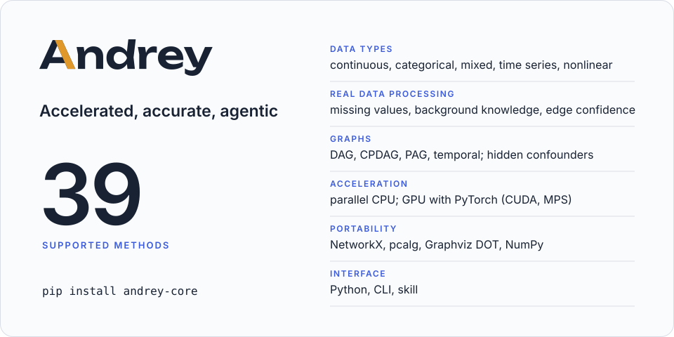

<!-- One image on its own dark ground reads on both GitHub themes; PyPI keeps a plain . The
banner links the website's homepage. -->
<p align="center">
  <a href="https://andrey.abel.ai/"></a>
</p>

<p align="center">
  <a href="https://pypi.org/project/andrey-core/"></a>
  <a href="https://github.com/Abel-ai-lab/andrey/actions/workflows/ci.yml"></a>
  
  <a href="https://github.com/Abel-ai-lab/andrey/blob/main/LICENSE"></a>
</p>

---

## ⭐ What's new in 0.16.0

0.16.0 is a release of fixes. Drawings mark each edge into an intervention target with a cross in
its middle, and `to_graphviz` draws the targets too; the graph types guide shows how to read every
mark. Every method that tests with HSIC keeps its p-values precise far below 1e-16, so ANM and PNL
pick the direction with the larger p-value even where both used to round to 0. FCI's documentation
says when test errors make it return a graph that is not a PAG.

**[Read the post](https://andrey.abel.ai/blog/20261015-andrey-0-4-0.html)** ·
**[See the release card](https://andrey.abel.ai/docs/benchmarks/0.16.0.html)**

---

Andrey is a causal discovery package for Python.

<!-- PITCH:START -->
<!-- Generated by apps/build_launch.py; do not edit. -->

- **Fast**: The fastest causal discovery package.
- **Accurate**: more than 80% fewer errors than other popular packages.
- **One API**: 44 supported methods, each one function call.
- **Any data**: continuous, categorical, mixed, time series, nonlinear, hidden confounders.
- **Agent-ready**: a command line that answers in JSON, and a skill for coding agents.

<!-- PITCH:END -->

```shell
uv add andrey-core
```

```shell
pip install andrey-core
```

You install andrey-core and then `import andrey`.

- **Optional extras**: `andrey-core[torch]` for GPUs and CALM, `andrey-core[viz]` for charts and
  graph layouts
- **From GitHub**, the latest release:
  `uv add "andrey-core @ git+https://github.com/Abel-ai-lab/andrey@main"`
- **[Installation guide](https://andrey.abel.ai/docs/guides/getting-started.html#install)**: the
  extras, a PyTorch build for your GPU, and building Andrey from source

<!-- CARD:START -->
<!-- Generated from andrey.spec by apps/build_launch.py; do not edit. -->

<p align="center">
  <picture>
    <source media="(prefers-color-scheme: dark)"
      srcset=".github/readme/package-card-dark.svg">
    
  </picture>
</p>

<p align="center"><a href="https://andrey.abel.ai/docs/benchmarks.html">Release cards</a></p>

<!-- CARD:END -->

## What's inside

<!-- METHODS:START -->
<!-- Generated from andrey.spec by apps/build_launch.py; do not edit. -->

| Family | Methods | Returns |
|---|---|---|
| Constraint-based | [`pc`](https://andrey.abel.ai/docs/api/andrey.pc.html), [`fci`](https://andrey.abel.ai/docs/api/andrey.fci.html), [`gfci`](https://andrey.abel.ai/docs/api/andrey.gfci.html), [`cdnod`](https://andrey.abel.ai/docs/api/andrey.cdnod.html), [`fci_jci`](https://andrey.abel.ai/docs/api/andrey.fci_jci.html), [`icp`](https://andrey.abel.ai/docs/api/andrey.icp.html), [`iamb`](https://andrey.abel.ai/docs/api/andrey.iamb.html), [`inter_iamb`](https://andrey.abel.ai/docs/api/andrey.inter_iamb.html), [`mmpc`](https://andrey.abel.ai/docs/api/andrey.mmpc.html) | CPDAG, PAG, DAG, Undirected graph |
| Score-based | [`ges`](https://andrey.abel.ai/docs/api/andrey.ges.html), [`gies`](https://andrey.abel.ai/docs/api/andrey.gies.html), [`gnies`](https://andrey.abel.ai/docs/api/andrey.gnies.html), [`xges`](https://andrey.abel.ai/docs/api/andrey.xges.html), [`hc`](https://andrey.abel.ai/docs/api/andrey.hc.html), [`tabu`](https://andrey.abel.ai/docs/api/andrey.tabu.html), [`exact_search`](https://andrey.abel.ai/docs/api/andrey.exact_search.html), [`calm`](https://andrey.abel.ai/docs/api/andrey.calm.html), [`notears`](https://andrey.abel.ai/docs/api/andrey.notears.html)\*, [`dagma`](https://andrey.abel.ai/docs/api/andrey.dagma.html)\*, [`mmhc`](https://andrey.abel.ai/docs/api/andrey.mmhc.html), [`rsmax2`](https://andrey.abel.ai/docs/api/andrey.rsmax2.html) | CPDAG, DAG |
| Permutation-based | [`boss`](https://andrey.abel.ai/docs/api/andrey.boss.html), [`grasp`](https://andrey.abel.ai/docs/api/andrey.grasp.html), [`boss_fci`](https://andrey.abel.ai/docs/api/andrey.boss_fci.html), [`grasp_fci`](https://andrey.abel.ai/docs/api/andrey.grasp_fci.html), [`igsp`](https://andrey.abel.ai/docs/api/andrey.igsp.html), [`ut_igsp`](https://andrey.abel.ai/docs/api/andrey.ut_igsp.html) | CPDAG, PAG |
| Functional causal models | [`direct_lingam`](https://andrey.abel.ai/docs/api/andrey.direct_lingam.html), [`ica_lingam`](https://andrey.abel.ai/docs/api/andrey.ica_lingam.html), [`multi_group_direct_lingam`](https://andrey.abel.ai/docs/api/andrey.multi_group_direct_lingam.html), [`cam`](https://andrey.abel.ai/docs/api/andrey.cam.html), [`resit`](https://andrey.abel.ai/docs/api/andrey.resit.html) | DAG |
| Temporal causal discovery | [`varma_lingam`](https://andrey.abel.ai/docs/api/andrey.varma_lingam.html), [`longitudinal_lingam`](https://andrey.abel.ai/docs/api/andrey.longitudinal_lingam.html), [`pcmci`](https://andrey.abel.ai/docs/api/andrey.pcmci.html), [`pcmciplus`](https://andrey.abel.ai/docs/api/andrey.pcmciplus.html), [`jpcmciplus`](https://andrey.abel.ai/docs/api/andrey.jpcmciplus.html), [`lpcmci`](https://andrey.abel.ai/docs/api/andrey.lpcmci.html), [`granger`](https://andrey.abel.ai/docs/api/andrey.granger.html), [`dynotears`](https://andrey.abel.ai/docs/api/andrey.dynotears.html) | Temporal graph |
| Latent variables | [`gin`](https://andrey.abel.ai/docs/api/andrey.gin.html), [`rcd`](https://andrey.abel.ai/docs/api/andrey.rcd.html), [`bottom_up_parce_lingam`](https://andrey.abel.ai/docs/api/andrey.bottom_up_parce_lingam.html), [`camuv`](https://andrey.abel.ai/docs/api/andrey.camuv.html) | DAG, PAG |
| Pairwise direction | [`anm`](https://andrey.abel.ai/docs/api/andrey.anm.html), [`pnl`](https://andrey.abel.ai/docs/api/andrey.pnl.html) | Two-node DAG |

\* [Experimental](https://andrey.abel.ai/docs/api.html#experimental-methods):
no published benchmark yet, and the API may change.

<!-- METHODS:END -->

## Quick start

<!-- QUICKSTART:START -->
<!-- Generated by apps/build_launch.py, which runs the code; do not edit. -->

Learn the protein-signaling network of Sachs et al. (2005) from 853 cells, and score it against the
known network:

```python
import andrey
from andrey.data import load_dataset
from andrey.metrics import score

sachs = load_dataset("sachs")  # 853 cells, 11 proteins, and the known network
out = andrey.pc(sachs.data)    # learn a graph
print(out)

scores = score(out.structure, sachs.graph)
print({k: round(scores[k], 2) for k in ("shd", "skeleton_precision", "skeleton_recall")})
```

```text
pc  cpdag  |  11 nodes  |  8 edges (6 undirected, 2 directed)

  raf -- mek
  plc -- pip3
  pip2 -- pip3
  erk -- akt
  erk -- pka
  akt -- pka
  p38 -> pkc
  jnk -> pkc

  indep_test: fisherz
  tie_break: rank
{'shd': 11, 'skeleton_precision': 1.0, 'skeleton_recall': 0.47}
```

PC finds 8 edges, all among the known network's 17. The structural Hamming distance (SHD) counts
the edges to add, remove, or reorient to reach the known network: 11 here (9 edges are missing, and
2 are oriented where the known network's CPDAG leaves them undirected), and 17 for a graph with no
edges.

<!-- QUICKSTART:END -->

For your own data, pass a pandas DataFrame or a NumPy array: one row per sample, one column per
variable. From a shell or an agent:

```shell
andrey run pc --data your_data.csv   # JSON when piped, a summary in a terminal
```

To give your coding agent Andrey's skill, paste this prompt into it:

```text
Install Andrey's agent skill: make sure the andrey-core package is installed, run
`andrey --skill`, and save its output as andrey/SKILL.md in your skills folder.
```

## Learn more

- [Documentation](https://andrey.abel.ai/docs/): guides and the API reference.
- [Examples](https://andrey.abel.ai/docs/examples/): notebooks, one method or task each.
- [Demos](https://andrey.abel.ai/docs/demos/): step through methods and explore results in your
  browser.
- [Release cards](https://andrey.abel.ai/docs/benchmarks.html): benchmark details for each
  release.
- [Why Andrey is fast](https://andrey.abel.ai/blog/20261008-why-andrey-is-fast.html)
- [FAQ](https://andrey.abel.ai/docs/faq.html) and
  [changelog](https://andrey.abel.ai/docs/changelog.html).
- [Roadmap](https://andrey.abel.ai/docs/roadmap.html): the planned work, stage by stage.

Andrey is in alpha: the API may change between releases, so pin the version you use. Linux is
supported; macOS and Windows install and run on the CPU, with no guarantee yet
([Testing](https://andrey.abel.ai/docs/ci.html)). Apple GPUs are not supported in the alpha.

## Citing, license, contributing

If you use Andrey in your work, please cite it, or use the
[citation file](https://github.com/Abel-ai-lab/andrey/blob/main/CITATION.cff):

```bibtex
@software{andrey,
  author = {{Abel AI Lab}},
  title = {Andrey: Accelerated, accurate, agentic causal discovery},
  year = {2026},
  version = {0.16.0},
  url = {https://andrey.abel.ai},
}
```

Andrey is released under the
[Apache License 2.0](https://github.com/Abel-ai-lab/andrey/blob/main/LICENSE). Bug reports and pull
requests are welcome in the [issue tracker](https://github.com/Abel-ai-lab/andrey/issues); the
[contributing guide](https://github.com/Abel-ai-lab/andrey/blob/main/CONTRIBUTING.md) explains how
to set up a development environment.

Andrey is inspired by
[causal-learn](https://github.com/py-why/causal-learn), [pgmpy](https://github.com/pgmpy/pgmpy),
[Tetrad](https://github.com/cmu-phil/tetrad), and many other causal discovery packages.
